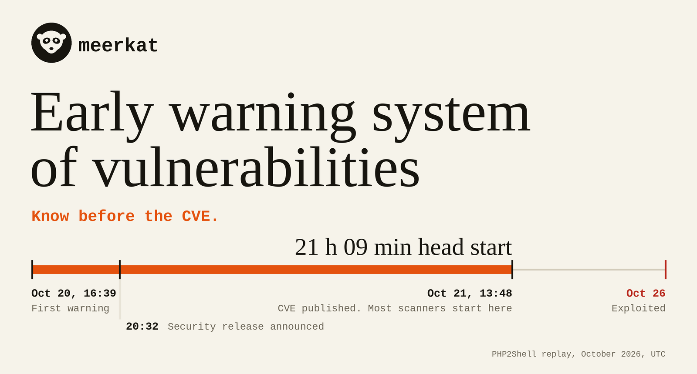

<a href="https://meerkatsec.win"><picture><source media="(prefers-color-scheme: dark)" srcset="docs/assets/hero-dark.png"></picture></a>

[](https://meerkatsec.win/r/github/bobby-ny/meerkat)
[](https://github.com/google/osv-scanner)
[](https://bobby-ny.github.io/meerkat/)
[](https://meerkatsec.win)
[](https://meerkatsec.win)
[](#private-code)
[](https://github.com/anchore/syft)
[](#alerts)
[](https://github.com/bobby-ny/meerkat/commits/main)
[](https://github.com/bobby-ny/meerkat/issues)
[](https://github.com/bobby-ny/meerkat/stargazers)

Meerkat emails you when a security problem affects a package or product you use, often before a CVE exists.

This repo contains the public site and docs. The service runs at [meerkatsec.win](https://meerkatsec.win).

- [Public GitHub repos](#public-github-repos)
- [Private code](#private-code)
- [Upload API](#upload-api)
- [Alerts](#alerts)
- [Supported ecosystems](#supported-ecosystems)
- [Badge](#badge)
- [Pricing](#pricing)

## Public GitHub repos

No install, token or GitHub App.

1. Sign up at <https://meerkatsec.win/start>.
2. Go to [Projects](https://meerkatsec.win/app/projects) > **Add a public GitHub repository**.
3. Enter `owner/repo` and click **Add and scan**.

Meerkat reads these files from the default branch:

| Type | Examples |
| --- | --- |
| Lockfiles | `package-lock.json`, `yarn.lock`, `pnpm-lock.yaml`, `poetry.lock`, `uv.lock`, `Cargo.lock`, `composer.lock`, `Gemfile.lock` |
| Manifests | `package.json`, `requirements.txt`, `pyproject.toml`, `go.mod`, `pom.xml`, `build.gradle` |
| Containers | `Dockerfile`, `Containerfile` |
| CI | `.github/workflows/*.yml` |

Alerts go to the email you signed up with. Add more addresses in Settings.

## Private code

Your source stays on your machine. Meerkat only receives package URLs.

```text
your machine or CI                                meerkat
+------------------------------------+
| source code      (never sent)      |
| lockfiles -> osv-scanner -> jq ----|---- purls ---> POST /api/v1/upload
+------------------------------------+
```

1. Sign up at <https://meerkatsec.win/start>.
2. Go to [Projects](https://meerkatsec.win/app/projects) > **Add a private project**, enter a name and click **Create project**.
3. Export the key it shows you:

```sh
export MEERKAT_UPLOAD_KEY=mku_...
```

4. Run this from your project root.

With [OSV-Scanner](https://github.com/google/osv-scanner):

```sh
osv-scanner scan source -r --offline --download-offline-databases --all-packages --format cyclonedx-1-5 . \
  | jq '{bomFormat,components:[.components[]|select(.purl)|{purl}]}' \
  | curl --fail-with-body --silent --show-error --header "Authorization: Bearer $MEERKAT_UPLOAD_KEY" --header "Content-Type: application/json" --data-binary @- https://meerkatsec.win/api/v1/upload
```

With [Syft](https://github.com/anchore/syft):

```sh
SYFT_CHECK_FOR_APP_UPDATE=false syft . -o cyclonedx-json \
  | jq '{bomFormat,components:[.components[]|select(.purl)|{purl}]}' \
  | curl --fail-with-body --silent --show-error --header "Authorization: Bearer $MEERKAT_UPLOAD_KEY" --header "Content-Type: application/json" --data-binary @- https://meerkatsec.win/api/v1/upload
```

Response:

```json
{"project":"billing-api","packages":142,"skipped":0,"ecosystems":{"npm":120,"pypi":22},"updated_at":"2026-11-18T10:00:00.000Z"}
```

To check the payload first, remove the last line of the command. It looks like this:

```json
{"bomFormat":"CycloneDX","components":[{"purl":"pkg:npm/lodash@4.17.20"},{"purl":"pkg:pypi/django@3.2.0"}]}
```

To leave out internal packages, change `select(.purl)` in the `jq` filter:

```sh
select(.purl and (.purl|contains("your-company")|not))
```

To try this without your own code, run it in [`examples/sample-project`](examples/sample-project).

### Update on every merge

Add `MEERKAT_UPLOAD_KEY` as a repository secret, then save this as `.github/workflows/meerkat.yml`:

```yaml
name: Meerkat package list
on:
  push:
    branches: [main]
permissions:
  contents: read
jobs:
  update:
    runs-on: ubuntu-latest
    steps:
      - uses: actions/checkout@3d3c42e5aac5ba805825da76410c181273ba90b1 # v7.0.1
      - name: Send package names and versions to Meerkat
        env:
          MEERKAT_UPLOAD_KEY: ${{ secrets.MEERKAT_UPLOAD_KEY }}
        run: |
          docker run --rm -v "$PWD:/src:ro" -w /src ghcr.io/google/osv-scanner:v2.7.1@sha256:a70ffffc2bfd33482953e5d6b64c6fcdb30239717a07b0f0d3ab2859ce3e4cde \
            scan source -r --offline --download-offline-databases --all-packages --format cyclonedx-1-5 . \
            | jq '{bomFormat,components:[.components[]|select(.purl)|{purl}]}' \
            | curl --fail-with-body --silent --show-error --header "Authorization: Bearer $MEERKAT_UPLOAD_KEY" --header "Content-Type: application/json" --data-binary @- https://meerkatsec.win/api/v1/upload
```

## Upload API

```http
POST https://meerkatsec.win/api/v1/upload
Authorization: Bearer mku_...
Content-Type: application/json
```

The body is a CycloneDX or SPDX JSON SBOM. Each upload replaces the project's package list. A rejected upload changes nothing.

| Status | Meaning |
| --- | --- |
| `200` | List replaced |
| `400` | Empty body |
| `401` | Missing or invalid key |
| `413` | Body over 5 MB |
| `422` | Not a valid SBOM, no packages, or over 10,000 packages |
| `429` | Over 20 uploads a minute for this key |

A key only works for one project and can only replace its package list.

## Alerts

One email thread per issue. Updates arrive as replies.

```text
From: Meerkat Alerts <alerts@meerkatsec.win>
Subject: [UNCONFIRMED][CRITICAL] Two critical flaws reported in PHP

Why you're getting this:
  - acme/api: uses PHP (affected version)
  - Watched product: PHP

What to do now:
  This is an early, unconfirmed report. A fix may not exist yet.
  Check where you use it, plan an emergency update window, and
  watch this thread: we will update it when the vendor confirms.

Timeline:
  - First public signal: 2026-10-20 16:39 UTC (before the CVE was published)
  - No CVE published yet
```

| Level | Name | Meaning | Action |
| --- | --- | --- | --- |
| L2 | Unconfirmed report | Early reports, no fix or CVE yet | Prepare |
| L3 | Release announced | Security release is coming | Book a window |
| L4 | Advisory published | Fixed versions are out | Update |
| L5 | Actively exploited | Attacks are happening | Patch now |

You set the lowest level that emails you instantly. Critical early reports are reviewed by a person before they are sent.

## Supported ecosystems

| Type | Supported |
| --- | --- |
| Packages | npm, PyPI, Maven, Go, crates.io, RubyGems, Packagist, NuGet, Pub, Hex, Swift |
| Containers and CI | Docker images, GitHub Actions |
| Linux | Debian, Ubuntu, Red Hat, SUSE, Alpine, Amazon Linux |
| Products | Microsoft, Apple, Google, Cisco, Fortinet, Palo Alto Networks, Ivanti, Citrix, VMware, Oracle, SAP, Atlassian, Siemens, Kubernetes, WordPress, OpenSSL, PHP, nginx, Jenkins, GitLab and others |

If your lockfile pins a version that isn't affected, you don't get an alert.

## Badge

```markdown
[](https://meerkatsec.win/r/github/OWNER/REPO)
```

Card with package counts by ecosystem:

```markdown
[](https://meerkatsec.win/r/github/OWNER/REPO)
```

[](https://meerkatsec.win/r/github/bobby-ny/meerkat)

The badge shows the number of packages watched in a public repo.

## Pricing

| | Individual | Team | Business |
| --- | --- | --- | --- |
| Price | Free | $5/month | $50/month |
| Projects | 3 | 15 | 100 |
| Private projects | 1 | 15 | 100 |
| Extra watched items | 25 | 150 | 1,000 |
| Users | 1 | 5 | 25 |
| Slack and webhooks | No | Yes | Yes |
| API | No | No | Yes |
| Audit log | No | No | Yes |

Each user can invite 3 people.

## Security

See [SECURITY.md](SECURITY.md).
